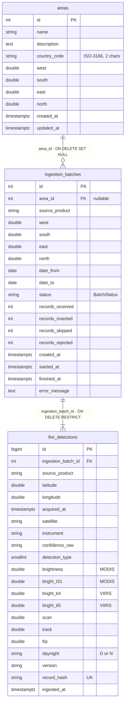
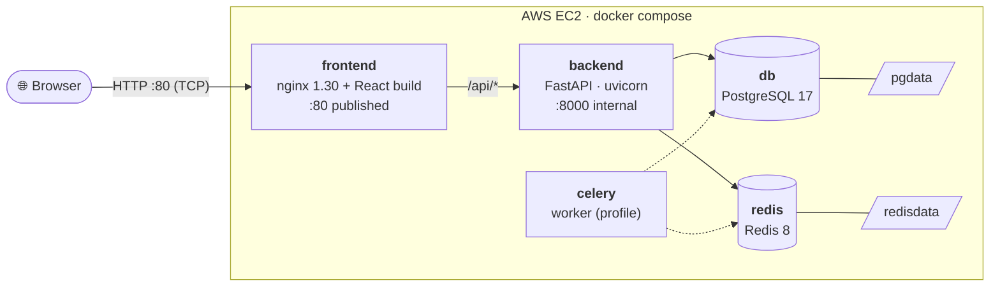
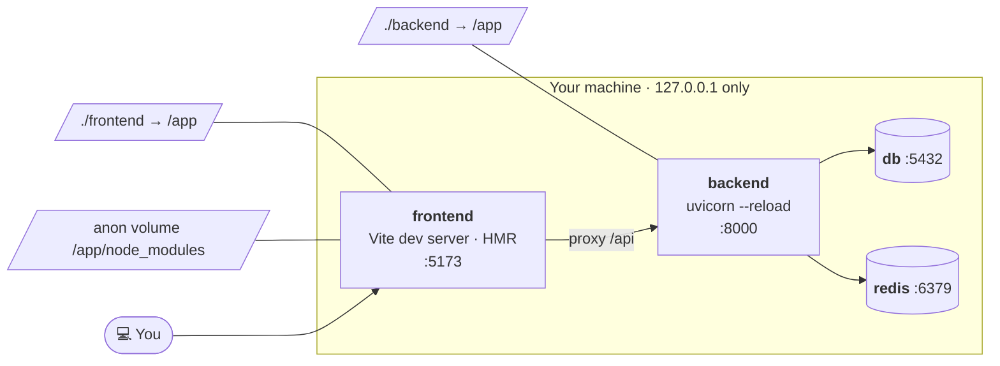
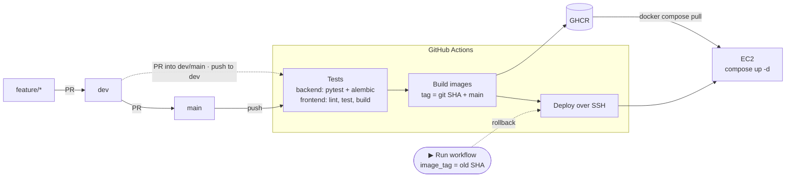

# MODIS × VIIRS Harmonized

Historical wildfire hotspots from NASA FIRMS, with the MODIS and VIIRS sensors placed on one shared grid. You can explore history, seasonality and anomalies on a map, in an activity calendar and in a per-year chart.

### Stack

**Backend**


**Data**


**Frontend**


**Infrastructure**


> Versions are the ones resolved on 2026-11-13. Image tags (`postgres:17-alpine`, `redis:8-alpine`, `nginx:stable-alpine`, `node:24-alpine`) track the latest patch release of that line.

---

## Contents
- [Architecture](#architecture)
- [Backend: data model](#backend-data-model)
- [Frontend](#frontend)
- [Containers](#containers)
- [CI/CD](#cicd)
- [Local development](#local-development)

---

## Architecture

```text
modis-viirs-harmonized/
├── backend/                         FastAPI monolith
│   ├── app/
│   │   ├── core/
│   │   │   ├── database.py          async engine, session factory, DeclarativeBase
│   │   │   ├── settings.py          pydantic-settings, reads backend/.env
│   │   │   ├── enums.py             DayNight, BatchStatus
│   │   │   └── geo.py               lon_filter(): bbox longitude filter (antimeridian-safe)
│   │   └── models/
│   │       ├── areas.py             Area           → table "areas"
│   │       ├── ingestion_batches.py IngestionBatch → table "ingestion_batches"
│   │       └── fire_detections.py   FireDetection  → table "fire_detections"
│   ├── alembic/                     migrations (async env.py)
│   ├── alembic.ini
│   ├── requirements.txt
│   ├── Dockerfile                   prod image: migrate on start, then uvicorn, non-root
│   ├── Dockerfile.dev               deps only, code bind-mounted, --reload
│   └── .env.example
├── frontend/                        Vite + React + TypeScript
│   ├── src/                         SPA source
│   ├── nginx/default.conf           prod web server: SPA + /api reverse proxy
│   ├── vite.config.ts               dev proxy /api → backend
│   ├── Dockerfile                   multi-stage: node build → nginx
│   └── Dockerfile.dev               vite dev server with HMR
├── deploy/
│   └── remote-deploy.sh             runs on EC2 during deploy
├── .github/workflows/ci-cd.yml      test → build → push → deploy
├── docker-compose.yml               prod stack (EC2)
├── docker-compose.dev.yml           local dev stack
└── .nvmrc                           Node 24
```

---

## Backend: data model

There are three tables, plus two enums and one geo helper.

| Table | Model | What it stores |
|---|---|---|
| `areas` | `Area` | Named regions of interest: a bounding box (`west/south/east/north`), an optional ISO-3166 `country_code`, and a description. These are the regions users pick on the map. |
| `ingestion_batches` | `IngestionBatch` | One row per import run from NASA FIRMS: product, bbox, date range, `status` (`pending → running → completed / partial / failed`), counters (`received / inserted / skipped / rejected`), timings and `error_message`. This is the audit trail of every import. |
| `fire_detections` | `FireDetection` | Individual hotspots from MODIS/VIIRS: position, `acquired_at`, satellite and instrument, brightness channels (`brightness`/`bright_t31` for MODIS, `bright_ti4`/`bright_ti5` for VIIRS), `scan`/`track` pixel size, `frp` (fire radiative power), `confidence_raw`, `daynight`. `record_hash` is unique, so re-importing the same data skips duplicates instead of duplicating them. |

| Enum | Values |
|---|---|
| `DayNight` | `D`, `N` |
| `BatchStatus` | `pending`, `running`, `completed`, `partial`, `failed` |

### Relationships



- Deleting an **area** keeps its import history: the batches stay and their `area_id` becomes `NULL`.
- A **batch** that still has detections cannot be deleted (`RESTRICT`), so no hotspot ever loses its provenance.
- A batch copies its bbox from the area instead of referencing it, so editing an area doesn't rewrite what was actually imported.

### Bounding boxes and the antimeridian

Both bbox tables check that coordinates are in range (`-180..180`, `-90..90`), that `south < north`, and that `west <> east`.

- `west < east`: a normal region, for example Ukraine `22 → 40.5`.
- `west > east`: the region **crosses the 180° meridian**, for example Chukotka `170 → -170`.

`app/core/geo.py::lon_filter()` turns this into the right SQL. That is `BETWEEN west AND east` for normal boxes and `lon >= west OR lon <= east` for boxes that cross 180°. Always filter longitude through it.

---

## Frontend

The frontend is a Vite + React + TypeScript scaffold. Planned features: a Leaflet + OpenStreetMap map with MODIS/VIIRS layers, period and sensor filters, an activity calendar, and a per-year chart.

In development, Vite proxies `/api` to the backend (`VITE_API_PROXY_TARGET`, by default `http://localhost:8000`), so the frontend always calls relative `/api/...` URLs.

### nginx (production)

The prod frontend image **is** the web server. It is a multi-stage build: `node:24-alpine` runs `npm run build`, then `nginx:stable-alpine` serves `dist/`. Config: [`frontend/nginx/default.conf`](frontend/nginx/default.conf).

| Location | Behaviour |
|---|---|
| `/` | SPA. `try_files … /index.html`, so client-side routes and deep links work. `index.html` is sent with `Cache-Control: no-cache`, so a new deploy is picked up immediately. |
| `/assets/` | Hashed Vite bundles, cached with `public, max-age=31536000, immutable`. |
| `/api/` | Reverse proxy to `backend:8000`, keeping the `/api` prefix. Sends `X-Forwarded-*` headers and supports WebSocket upgrades. |

- nginx resolves `backend` per request through Docker DNS (`resolver 127.0.0.11`), so it **starts even if the backend is down**. Clients get `502` until the backend is up, instead of nginx crash-looping.
- gzip is on for text, JS, JSON and SVG. Security headers: `nosniff`, `SAMEORIGIN`, `strict-origin-when-cross-origin`. `server_tokens off`.
- It listens on **TCP 80 only**. HTTP/1.1 and HTTP/2 run over TCP. UDP would only be needed for HTTP/3 (QUIC), which this project doesn't use. TLS on 443 will be added together with a domain.

---

## Containers

### Production (`docker-compose.yml`, on EC2)



| Service | Image | Exposed | Volume | Notes |
|---|---|---|---|---|
| `frontend` | `ghcr.io/…-frontend:<sha>` | **`80:80`** | none | The only public entrypoint |
| `backend` | `ghcr.io/…-backend:<sha>` | internal `8000` | none | Runs `alembic upgrade head` on start; non-root user |
| `celery` | same as backend | none | none | Behind `profiles: [celery]` until `app/worker.py` exists |
| `db` | `postgres:17-alpine` | internal | `pgdata` | Healthcheck `pg_isready` |
| `redis` | `redis:8-alpine` | internal | `redisdata` | AOF persistence, healthcheck `redis-cli ping` |

All services restart `unless-stopped` and rotate logs (10 MB × 3). Config comes from `/opt/modis-viirs/.env` on the server.

### Development (`docker-compose.dev.yml`)



- Source code is bind-mounted, so edits reload instantly on both sides.
- `node_modules` lives in an anonymous volume, so the host's `node_modules` (built for another OS) never shadows the container's.
- Every port is bound to `127.0.0.1`. Docker bypasses `ufw`/`firewalld`, so a bare `5432:5432` would expose the dev database (`postgres/postgres`) to the whole Wi-Fi.

---

## CI/CD

Workflow: [`.github/workflows/ci-cd.yml`](.github/workflows/ci-cd.yml)



| Trigger | Tests | Build → GHCR | Deploy |
|---|:-:|:-:|:-:|
| PR into `dev` / `main` | ✅ | | |
| push to `dev` | ✅ | | |
| push to `main` (incl. merged PR) | ✅ | ✅ | ✅ |
| manual run with `image_tag` | | | ✅ (rollback) |

How it works:
1. **Detect.** Jobs for parts of the repo that don't exist yet are skipped, not failed.
2. **Backend tests** run on Python 3.14 against a real Postgres 17 service. `alembic upgrade head` proves the migrations apply, then `pytest` runs. "No tests collected" is reported as a warning, not a failure.
3. **Frontend tests** run on Node from `.nvmrc`: `npm ci`, then `lint`, `typecheck`, `test` (each only if the script exists), then `build`.
4. **Build** happens only after green tests on `main`. Each component is pushed to `ghcr.io/<owner>/<repo>-{backend,frontend}` as `:<sha>` and `:main`. Old SHA tags stay, so every past release is available for rollback.
5. **Deploy** is gated by the repo variable `DEPLOY_ENABLED=true`. The job copies `docker-compose.yml` and `deploy/remote-deploy.sh` to the server and runs the script over SSH. The script logs in to GHCR with the run's short-lived `GITHUB_TOKEN` (sent via stdin, never in process args), runs `compose pull && up -d`, logs out, appends to `deployments.log` and prunes old images.
6. **Rollback.** Actions → CI/CD → *Run workflow*, set `image_tag` to an older SHA. It redeploys that image without rebuilding.

No AWS credentials are needed: images live in GHCR and the server is reached over SSH.

### Required settings

| Kind | Name | Value |
|---|---|---|
| Secret | `EC2_HOST` | Instance IP / hostname (use an Elastic IP) |
| Secret | `EC2_USER` | `ubuntu` / `ec2-user` (must be in the `docker` group) |
| Secret | `EC2_SSH_KEY` | Private key of a **deploy-only** key pair |
| Secret | `EC2_KNOWN_HOSTS` | Output of `ssh-keyscan -H <host>` (recommended) |
| Variable | `DEPLOY_ENABLED` | `true` once the server is prepared |
| Variable | `DEPLOY_DIR` | Default `/opt/modis-viirs` |
| Variable | `HEALTHCHECK_URL` | e.g. `http://<host>/api/health` (optional) |
| Environment | `production` | Used by the deploy job |

---

## Local development

```bash
# 1. backend config (optional for dev; DB/Redis URLs are set by compose)
cp backend/.env.example backend/.env      # add FIRMS_MAP_KEY

# 2. start everything
docker compose -f docker-compose.dev.yml up --build

# frontend  → http://localhost:5173
# backend   → http://localhost:8000
# postgres  → localhost:5432  (postgres / postgres, db "firms")

# with the celery worker
docker compose -f docker-compose.dev.yml --profile celery up --build

# after changing package.json: recreate the node_modules volume
docker compose -f docker-compose.dev.yml up --build -V frontend
```

Get a FIRMS map key at <https://firms.modaps.eosdis.nasa.gov/api/map_key/>.
