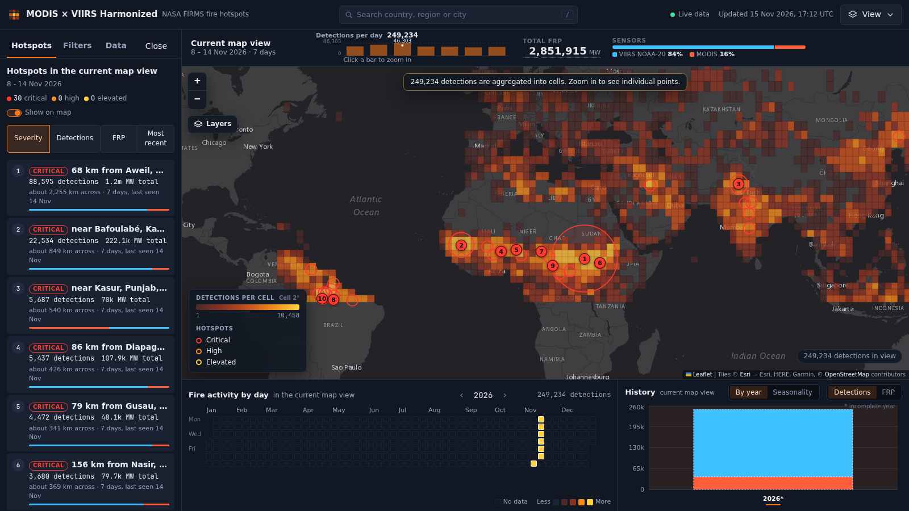
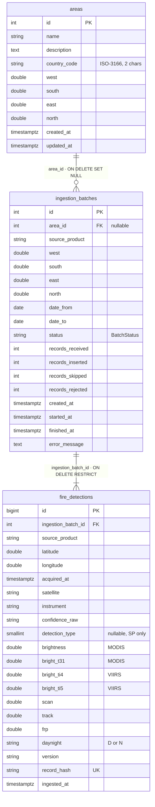
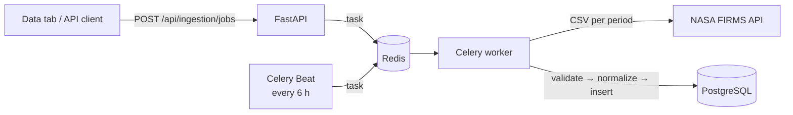
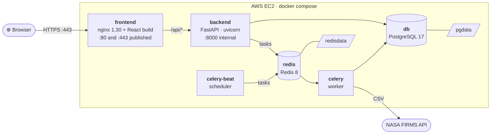
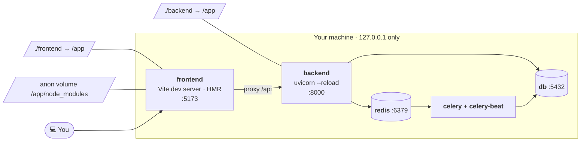
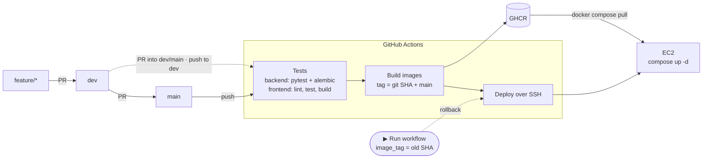

# MODIS × VIIRS Harmonized

Wildfire hotspots from NASA FIRMS, with the MODIS and VIIRS sensors brought to one schema and shown on one map. You can load any period and area from FIRMS, then explore it on the map, in a ranked hotspot list, in an activity calendar and in history charts.

- **Live site:** <https://modis-viirs-harmonized.duckdns.org>
- **User guide for evaluators:** [`docs/USER_GUIDE.md`](docs/USER_GUIDE.md)
- **API reference (Swagger UI):** <https://modis-viirs-harmonized.duckdns.org/api/docs>



### Stack

**Backend**


**Data**


**Frontend**


**Infrastructure**


> Versions are the ones resolved on 2026-11-13. Image tags (`postgres:17-alpine`, `redis:8-alpine`, `nginx:stable-alpine`, `node:24-alpine`) track the latest patch release of that line.

---

## Contents
- [Architecture](#architecture)
- [Backend: data model](#backend-data-model)
- [Backend: harmonization](#backend-harmonization)
- [Backend: API](#backend-api)
- [Backend: ingestion](#backend-ingestion)
- [Frontend](#frontend)
- [Containers](#containers)
- [CI/CD](#cicd)
- [Infrastructure](#infrastructure)
- [Local development](#local-development)
- [Known limitations](#known-limitations)

---

## Architecture

```text
modis-viirs-harmonized/
├── backend/                         FastAPI monolith
│   ├── app/
│   │   ├── main.py                  FastAPI app, routers, /api and /api/health
│   │   ├── celery_app.py            Celery app and the Beat schedule
│   │   ├── api/
│   │   │   ├── routes/              meta, detections, hotspots, timeseries, ingestion
│   │   │   └── dependencies/        shared query filters (period, bbox, sensors, ...)
│   │   ├── core/                    settings, database, enums, geo (antimeridian-safe bbox)
│   │   ├── integrations/firms/      client, planner, validator, parser, normalizer,
│   │   │                            persistence, pipeline, availability
│   │   ├── models/                  Area, IngestionBatch, FireDetection
│   │   ├── repositories/            SQL for detections, grid, hotspots, timeseries, metadata
│   │   ├── schemas/                 Pydantic request and response models
│   │   ├── services/hotspots.py     grouping detections into ranked hotspots
│   │   └── tasks/                   Celery tasks: ingestion, six-hourly scheduler
│   ├── alembic/                     migrations (async env.py)
│   ├── tests/                       pytest suite
│   ├── alembic.ini
│   ├── requirements.txt             runtime deps (requirements-test.txt for tests)
│   ├── Dockerfile                   prod image: migrate on start, then uvicorn, non-root
│   ├── Dockerfile.dev               deps only, code bind-mounted, --reload
│   └── .env.example
├── frontend/                        Vite + React + TypeScript (see frontend/README.md)
│   ├── src/                         SPA source: api/, features/, state/, lib/, i18n/
│   ├── nginx/default.conf           prod web server: SPA + /api reverse proxy
│   ├── vite.config.ts               dev proxy /api → backend
│   ├── Dockerfile                   multi-stage: node build → nginx
│   └── Dockerfile.dev               vite dev server with HMR
├── deploy/
│   └── remote-deploy.sh             runs on EC2 during deploy
├── infra/                           Terraform: EC2 instance, security group, Elastic IP
├── docs/                            user guide and screenshots
├── .github/workflows/ci-cd.yml      test → build → push → deploy
├── docker-compose.yml               prod stack (EC2)
├── docker-compose.dev.yml           local dev stack
└── .nvmrc                           Node 24
```

---

## Backend: data model

There are three tables, plus two enums and one geo helper.

| Table | Model | What it stores |
|---|---|---|
| `areas` | `Area` | Named regions of interest: a bounding box (`west/south/east/north`), an optional ISO-3166 `country_code`, and a description. These are the regions users pick on the map. |
| `ingestion_batches` | `IngestionBatch` | One row per import run from NASA FIRMS: product, bbox, date range, `status` (`pending → running → completed / partial / failed`), counters (`received / inserted / skipped / rejected`), timings and `error_message`. This is the audit trail of every import. |
| `fire_detections` | `FireDetection` | Individual hotspots from MODIS/VIIRS: position, `acquired_at`, satellite and instrument, brightness channels (`brightness`/`bright_t31` for MODIS, `bright_ti4`/`bright_ti5` for VIIRS), `scan`/`track` pixel size, `frp` (fire radiative power), `confidence_raw`, `daynight`, and `detection_type` (empty for near real-time products). Indexed by `acquired_at`, by `latitude, longitude` and by `source_product, acquired_at`. `record_hash` is unique, so re-importing the same data skips duplicates instead of duplicating them. |

| Enum | Values |
|---|---|
| `DayNight` | `D`, `N` |
| `BatchStatus` | `pending`, `running`, `completed`, `partial`, `failed` |

### Relationships



- Deleting an **area** keeps its import history: the batches stay and their `area_id` becomes `NULL`.
- A **batch** that still has detections cannot be deleted (`RESTRICT`), so no hotspot ever loses its provenance.
- A batch copies its bbox from the area instead of referencing it, so editing an area doesn't rewrite what was actually imported.

### Bounding boxes and the antimeridian

Both bbox tables check that coordinates are in range (`-180..180`, `-90..90`), that `south < north`, and that `west <> east`.

- `west < east`: a normal region, for example Ukraine `22 → 40.5`.
- `west > east`: the region **crosses the 180° meridian**, for example Chukotka `170 → -170`.

`app/core/geo.py::lon_filter()` turns this into the right SQL. That is `BETWEEN west AND east` for normal boxes and `lon >= west OR lon <= east` for boxes that cross 180°. Always filter longitude through it.

---

## Backend: harmonization

MODIS and VIIRS describe the same fire with different columns. Records from both land in `fire_detections`, and the API returns one model.

| Field | MODIS | VIIRS | In the API |
|---|---|---|---|
| Confidence | `0`–`100` (%) | `l`, `n`, `h` | `low` (0–29, `l`), `nominal` (30–79, `n`), `high` (80–100, `h`). The raw value is stored as `confidence_raw` and returned next to the label. |
| Brightness | `brightness` (channel 21/22), `bright_t31` | `bright_ti4`, `bright_ti5` | All four columns kept; the ones that do not apply are `null`. |
| Pixel size | about 1 km | about 375 m | `scan` × `track` per detection. |
| Time | `acq_date` + `acq_time` (HHMM) | same | One UTC timestamp, `acquired_at`. |
| Detection type | `type`, SP only | `type`, SP only | `detection_type`, `null` for NRT. |

FIRMS publishes every sensor twice: near real-time (`*_NRT`, within hours) and standard processing (`*_SP`, later, science quality). The same fire can be in both, so the read endpoints never mix them: every request takes `processing=NRT` or `processing=SP`. The frontend shows this as the **Recent / Archive** switch.

Supported products: `MODIS_NRT`, `MODIS_SP`, `VIIRS_SNPP_NRT`, `VIIRS_SNPP_SP`, `VIIRS_NOAA20_NRT`, `VIIRS_NOAA20_SP`, `VIIRS_NOAA21_NRT`, `VIIRS_NOAA21_SP`.

---

## Backend: API

Interactive reference: `/api/docs` (Swagger UI). All endpoints are under `/api`.

| Method | Path | What it returns |
|---|---|---|
| `GET` | `/api/health` | Liveness; used by the container healthcheck and the deploy job. |
| `GET` | `/api/meta` | Which sources have data, with their date range and processing kind. |
| `GET` | `/api/detections` | Individual detections for a period and bounding box, with harmonized confidence. |
| `GET` | `/api/detections/{id}` | One detection with all fields. |
| `GET` | `/api/detections/grid` | Detections aggregated into grid cells, for zoomed-out map views. |
| `GET` | `/api/hotspots` | Detections grouped into hotspots and ranked by severity. |
| `GET` | `/api/stats/timeseries` | Counts and FRP per day, month or year, split by source. |
| `POST` | `/api/ingestion/jobs` | Starts a FIRMS download in the background. Answers `202` with a `task_id`. |
| `GET` | `/api/ingestion/jobs/{task_id}` | Status of that job: `PENDING`, `STARTED`, `SUCCESS` or `FAILURE`. |

The read endpoints share one set of filters: period, bounding box (may cross the antimeridian), sources, day/night, minimum confidence and `processing`.

Hotspots: detections closer than the grouping radius (10 km by default) form one group, and a group with at least 10 detections is a hotspot. A hotspot is `high` from 30 detections or 500 MW of total FRP, and `critical` from 100 detections or 2,000 MW; otherwise `elevated`.

---

## Backend: ingestion



A job is one FIRMS product, one bounding box and one date range:

```bash
curl -X POST https://modis-viirs-harmonized.duckdns.org/api/ingestion/jobs \
  -H 'Content-Type: application/json' \
  -d '{"source": "VIIRS_NOAA20_NRT", "west": 22, "south": 44, "east": 40.5, "north": 52.5,
       "start_date": "2026-11-08", "end_date": "2026-11-14"}'
```

What the worker does:

1. **Plan.** The date range is split into the periods FIRMS accepts per request. Periods that an earlier batch already covered are skipped. The exception is the most recent days of a near real-time product: they are downloaded again on every job, because FIRMS keeps adding detections to them; duplicates are dropped on insert.
2. **Download and validate.** A response that is not a FIRMS CSV (for example an error text) fails the batch instead of being read as "no fires".
3. **Normalize.** Each row becomes a `fire_detections` record. A row with missing required values is rejected and counted; the rest of the batch is kept.
4. **Insert** in chunks, skipping duplicates by `record_hash`.
5. **Report.** Every period is an `ingestion_batches` row with counters and an error message. If any period failed, or the period is outside what FIRMS has for that product, the job ends as `FAILURE`.

Celery Beat runs `schedule_nrt_ingestion` every six hours. It starts NRT jobs for each row of the `areas` table.

The FIRMS map key is read from `FIRMS_MAP_KEY` and never logged: the `httpx` logger is raised to `WARNING` because request URLs contain the key.

Tests: `cd backend && pip install -r requirements.txt -r requirements-test.txt && pytest`.

---

## Frontend

A React 19 + TypeScript single-page app built with Vite: a Leaflet map (grid cells when zoomed out, individual points when zoomed in), a sidebar with ranked hotspots, filters and data loading, a summary bar, a detection card, an activity calendar and history charts. Details, structure and conventions: [`frontend/README.md`](frontend/README.md) and [`frontend/ARCHITECTURE.md`](frontend/ARCHITECTURE.md). How to use the site: [`docs/USER_GUIDE.md`](docs/USER_GUIDE.md).

In development, Vite proxies `/api` to the backend (`VITE_API_PROXY_TARGET`, by default `http://localhost:8000`), so the frontend always calls relative `/api/...` URLs.

### nginx (production)

The prod frontend image **is** the web server. It is a multi-stage build: `node:24-alpine` runs `npm run build`, then `nginx:stable-alpine` serves `dist/`. Config: [`frontend/nginx/default.conf`](frontend/nginx/default.conf).

| Location | Behaviour |
|---|---|
| `/` | SPA. `try_files … /index.html`, so client-side routes and deep links work. `index.html` is sent with `Cache-Control: no-cache`, so a new deploy is picked up immediately. |
| `/assets/` | Hashed Vite bundles, cached with `public, max-age=31536000, immutable`. |
| `/api/` | Reverse proxy to `backend:8000`, keeping the `/api` prefix. Sends `X-Forwarded-*` headers and supports WebSocket upgrades. |

- nginx resolves `backend` per request through Docker DNS (`resolver 127.0.0.11`), so it **starts even if the backend is down**. Clients get `502` until the backend is up, instead of nginx crash-looping.
- gzip is on for text, JS, JSON and SVG. Security headers: `nosniff`, `SAMEORIGIN`, `strict-origin-when-cross-origin`. `server_tokens off`.
- It listens on **TCP 80 and 443**. Port 80 answers the Let's Encrypt HTTP challenge and redirects everything else to HTTPS. Port 443 serves the site over TLS with HTTP/2. Certificates are read from `./certbot/conf` on the server, mounted read-only.

---

## Containers

### Production (`docker-compose.yml`, on EC2)



| Service | Image | Exposed | Volume | Notes |
|---|---|---|---|---|
| `frontend` | `ghcr.io/…-frontend:<sha>` | **`80:80`, `443:443`** | `./certbot` (read-only) | The only public entrypoint |
| `backend` | `ghcr.io/…-backend:<sha>` | internal `8000` | none | Runs `alembic upgrade head` on start; non-root user. Healthcheck: `GET /api/health` |
| `celery` | same as backend | none | none | Worker: `celery -A app.celery_app:celery_app worker`. Healthcheck: `celery inspect ping` |
| `celery-beat` | same as backend | none | none | Scheduler; must run as a single instance |
| `db` | `postgres:17-alpine` | internal | `pgdata` | Healthcheck `pg_isready` |
| `redis` | `redis:8-alpine` | internal | `redisdata` | AOF persistence, healthcheck `redis-cli ping` |

All services restart `unless-stopped` and rotate logs (10 MB × 3). The worker and Beat start only after `db`, `redis` and `backend` are healthy, so migrations are always applied first. Config comes from `/opt/modis-viirs/.env` on the server.

### Development (`docker-compose.dev.yml`)



- Source code is bind-mounted, so edits reload instantly on both sides.
- `node_modules` lives in an anonymous volume, so the host's `node_modules` (built for another OS) never shadows the container's.
- Every port is bound to `127.0.0.1`. Docker bypasses `ufw`/`firewalld`, so a bare `5432:5432` would expose the dev database (`postgres/postgres`) to the whole Wi-Fi.

---

## CI/CD

Workflow: [`.github/workflows/ci-cd.yml`](.github/workflows/ci-cd.yml)



| Trigger | Tests | Build → GHCR | Deploy |
|---|:-:|:-:|:-:|
| PR into `dev` / `main` | ✅ | | |
| push to `dev` | ✅ | | |
| push to `main` (incl. merged PR) | ✅ | ✅ | ✅ |
| manual run with `image_tag` | | | ✅ (rollback) |

How it works:
1. **Detect.** Jobs for parts of the repo that don't exist yet are skipped, not failed.
2. **Backend tests** run on Python 3.14 against a real Postgres 17 service. `alembic upgrade head` proves the migrations apply, then `pytest` runs. "No tests collected" is reported as a warning, not a failure.
3. **Frontend tests** run on Node from `.nvmrc`: `npm ci`, then `lint`, `typecheck`, `test` (each only if the script exists), then `build`.
4. **Build** happens only after green tests on `main`. Each component is pushed to `ghcr.io/<owner>/<repo>-{backend,frontend}` as `:<sha>` and `:main`. Old SHA tags stay, so every past release is available for rollback.
5. **Deploy** is gated by the repo variable `DEPLOY_ENABLED=true`. The job copies `docker-compose.yml` and `deploy/remote-deploy.sh` to the server and runs the script over SSH. The script logs in to GHCR with the run's short-lived `GITHUB_TOKEN` (sent via stdin, never in process args), writes the `KEY=VALUE` settings it receives the same way into `.env` on the server, runs `compose pull && up -d`, logs out, appends to `deployments.log` and prunes old images.
6. **Rollback.** Actions → CI/CD → *Run workflow*, set `image_tag` to an older SHA. It redeploys that image without rebuilding.

No AWS credentials are needed: images live in GHCR and the server is reached over SSH.

### Required settings

| Kind | Name | Value |
|---|---|---|
| Secret | `EC2_HOST` | Instance IP / hostname (use an Elastic IP) |
| Secret | `EC2_USER` | `ubuntu` / `ec2-user` (must be in the `docker` group) |
| Secret | `EC2_SSH_KEY` | Private key of a **deploy-only** key pair |
| Secret | `EC2_KNOWN_HOSTS` | Output of `ssh-keyscan -H <host>` (recommended) |
| Secret | `CELERY_BROKER_URL` | `redis://redis:6379/0`; written to the server's `.env` on every deploy |
| Secret | `CELERY_RESULT_BACKEND` | `redis://redis:6379/1`; same |
| Variable | `DEPLOY_ENABLED` | `true` once the server is prepared |
| Variable | `DEPLOY_DIR` | Default `/opt/modis-viirs` |
| Variable | `HEALTHCHECK_URL` | e.g. `https://<host>/api/health` (optional) |
| Environment | `production` | Used by the deploy job |

The database settings and `FIRMS_MAP_KEY` are not in GitHub. They are set once by hand in `/opt/modis-viirs/.env` on the server (mode `600`); deploys keep them.

---

## Infrastructure

[`infra/`](infra/) is a small Terraform project for the server: one EC2 instance with Docker installed by `user_data`, a security group that opens 80, 443 and SSH, a deploy key pair and an Elastic IP.

```bash
cd infra
cp terraform.tfvars.example terraform.tfvars   # fill in
terraform init && terraform apply
```

---

## Local development

```bash
# 1. backend config: only FIRMS_MAP_KEY is needed, compose sets the DB and Redis URLs
cp backend/.env.example backend/.env

# 2. start everything: db, redis, backend, celery worker, celery beat, frontend
docker compose -f docker-compose.dev.yml up --build

# frontend  → http://localhost:5173
# backend   → http://localhost:8000   (API reference at /api/docs)
# postgres  → localhost:5432  (postgres / postgres, db "firms")

# checks
docker compose -f docker-compose.dev.yml exec backend alembic current
docker compose -f docker-compose.dev.yml exec celery celery -A app.celery_app:celery_app inspect ping

# after changing package.json: recreate the node_modules volume
docker compose -f docker-compose.dev.yml up --build -V frontend
```

The dev backend applies migrations on start. The database starts empty: open the site, go to the **Data** tab and load a period, or post a job to `/api/ingestion/jobs`. Until the database has data the frontend shows built-in demo data and says so in the header.

Get a FIRMS map key at <https://firms.modaps.eosdis.nasa.gov/api/map_key/>.

---

## Known limitations

- The six-hourly schedule loads only areas saved in the `areas` table, and nothing creates them yet, so new data arrives when someone starts a job.
- `POST /api/ingestion/jobs` has no authentication and no limit on the date range. The frontend limits a job to 31 days.
- There is no endpoint that lists jobs. The frontend remembers the jobs started from that browser.
