# MODIS × VIIRS Harmonized: user guide

This guide is for people evaluating the site. It explains what each part of the screen does and how to try the main features yourself.

**Site:** <https://modis-viirs-harmonized.duckdns.org>

The site shows active fire detections from NASA FIRMS on one map. FIRMS publishes MODIS and VIIRS data in different formats; here both are brought to one schema, so you can filter, count and compare them together. You can also load a new period and area from FIRMS yourself.

Nothing needs to be installed and there is no sign-in. A desktop browser works best.

## Contents

- [A two-minute tour](#a-two-minute-tour)
- [The screen at a glance](#the-screen-at-a-glance)
- [Map](#map)
- [Search](#search)
- [Hotspots](#hotspots)
- [Filters](#filters)
- [Summary bar](#summary-bar)
- [Detection card](#detection-card)
- [Calendar and history charts](#calendar-and-history-charts)
- [Loading data from FIRMS](#loading-data-from-firms)
- [View menu](#view-menu)
- [API](#api)
- [Good to know](#good-to-know)

## A two-minute tour

1. Open the site. The badge in the header should say **Live data**. The map shows the last 7 days that have data.
2. Look at the **Hotspots** tab on the left. It ranks the places where detections are densest in the current map view. Click the first row: the map zooms to that hotspot.
3. Zoom in with the mouse wheel until the coloured cells turn into dots. Each dot is one detection. Click a dot to open its card on the right.
4. In the card, find **Confidence**. It shows the level on the shared scale (Low, Nominal, High) next to the raw value the sensor reported.
5. Type a country, region or city in the search box, for example `Ukraine`, and pick a result. The map, the hotspot list, the summary and the charts now describe that place.
6. Open the **Filters** tab. Switch a sensor off, or set **Minimum confidence** to **High**, and watch the numbers change.
7. Open the **Data** tab and start a download for a period that is not loaded yet (see [Loading data from FIRMS](#loading-data-from-firms)).

## The screen at a glance

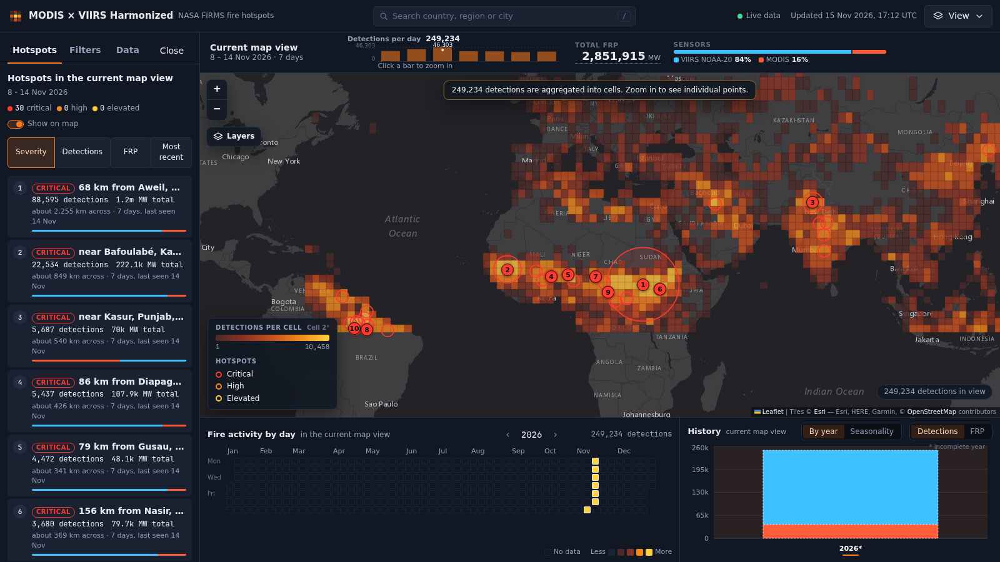

| Area | What it is |
|---|---|
| Header | Search box, the data badge (**Live data** or **Demo data**), the time of the last update and the **View** menu. |
| Sidebar (left) | Three tabs: **Hotspots**, **Filters** and **Data**. **Close** hides it. |
| Summary bar | Detections per day, total fire radiative power and the share of each sensor. |
| Map | Every detection for the chosen period. |
| Bottom row | A calendar of fire activity by day, and a history chart. |

Everything on screen describes the same slice of data: the chosen period and filters, inside the selected place or, when no place is selected, inside the current map view. Pan or zoom the map and the numbers follow.

## Map

The map changes how it draws detections depending on the zoom.

**Zoomed out**, detections are added up into square cells. Brighter cells hold more detections. A note at the top says how many detections were aggregated. Click a cell to zoom in.

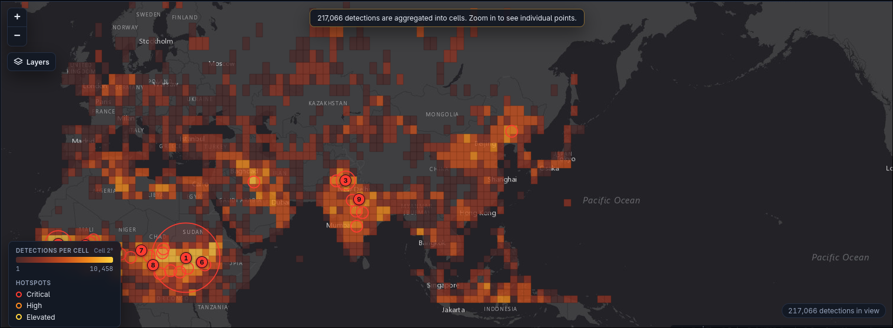

**Zoomed in**, every detection is a dot. The counter in the bottom-right corner says how many are in view.

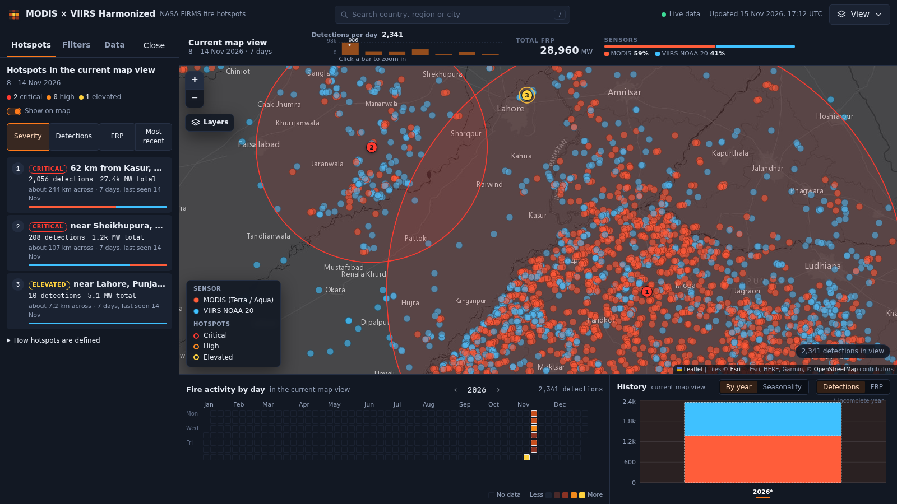

The **Layers** button (top left of the map) opens three settings:

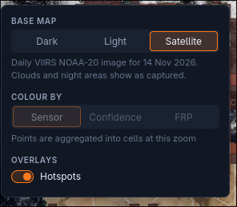

- **Base map:** Dark, Light or Satellite. Satellite is the daily VIIRS NOAA-20 true-colour image from NASA GIBS for the last day of the period, so clouds and night areas show as they were captured.
- **Colour by:** Sensor, Confidence or FRP. This applies to dots; it is disabled while the map shows cells.
- **Overlays:** switches the hotspot rings on and off.

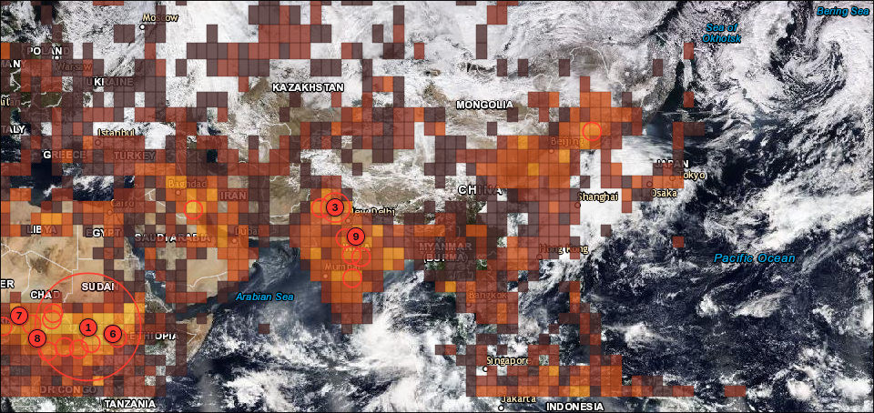

The **legend** in the bottom-left corner explains the colours currently on the map: the cell scale or the dot colours, and the three hotspot levels.

## Search

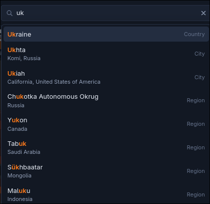

The search box finds countries, regions and cities. Press `/` to jump to it. Pick a result and the map flies there and draws the outline of the place. From then on every panel describes that place instead of the map view.

To go back to the map view, click the **×** next to the place name in the summary bar, or **Clear** in the Filters tab.

## Hotspots

A **detection** is one satellite pixel where a sensor saw fire. A **hotspot** is a group of detections that belong to the same burning area.

- Two detections closer than **10 km** are linked. Links chain, so a long fire front becomes one hotspot.
- A group is listed once it has at least **10 detections** in the period.
- Each hotspot gets a level. The higher level applies as soon as either number is reached:

| Level | Detections | or total FRP |
|---|---|---|
| Critical | 100 or more | 2,000 MW or more |
| High | 30 or more | 500 MW or more |
| Elevated | 10 or more | below 500 MW |

The **Hotspots** tab lists them, strongest first. Each row shows the level, the nearest city, the number of detections, total FRP, how far the group spreads, how many days it was active and the mix of sensors (the coloured line under the row).

- Sort by **Severity**, **Detections**, **FRP** or **Most recent**.
- Click a row to zoom the map to that hotspot.
- The number in a ring on the map is the rank in the list. Click a ring to find it in the list.
- **Show on map** switches the rings on and off.
- **How hotspots are defined**, at the bottom of the list, repeats these rules.

If a short period has no hotspots, the panel offers to search a longer one.

## Filters

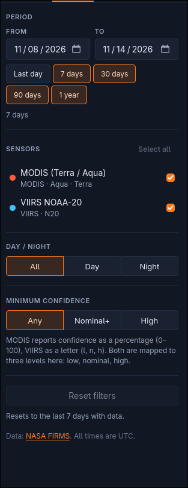

| Filter | What it does |
|---|---|
| **Data: Recent / Archive** | Shown only when the database holds both kinds. See below. |
| **Period** | Exact dates, or a quick period: Last day, 7 days, 30 days, 90 days, 1 year. Quick periods end on the last day that has data. |
| **Sensors** | Switch sensors on and off. At least one stays on. |
| **Day / night** | All, daytime passes only, or night-time passes only. |
| **Minimum confidence** | Any, Nominal+ or High, on the shared scale. |

**Reset filters** returns to the last 7 days with data and keeps the selected place.

### The shared confidence scale

MODIS reports confidence as a percentage and VIIRS as a letter. The site maps both to three levels:

| Level | MODIS | VIIRS |
|---|---|---|
| Low | 0–29 | `l` |
| Nominal | 30–79 | `n` |
| High | 80–100 | `h` |

So **Nominal+** means "30 % or more" for a MODIS detection and "`n` or `h`" for a VIIRS one. The raw value is never lost: the detection card shows it next to the level.

### Recent and Archive

FIRMS publishes every sensor in two versions:

- **Recent** (near real-time, NRT): available within hours of the satellite pass.
- **Archive** (standard processing, SP): quality-checked, published a few months later. It also carries a detection type, such as vegetation fire or volcano.

The same fire can appear in both, so the site never mixes them. If only one kind is loaded, the site uses it and the switch is hidden.

## Summary bar

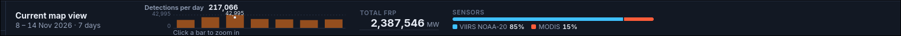

From left to right:

- The scope (**Current map view** or the selected place) and the period.
- **Detections per day** as a small bar chart, with the total above it. Hover a bar to read that day. **Click a bar to zoom into that day**; a **Back to…** button then returns to the previous period. For long periods the bars are months or years.
- **Total FRP**: fire radiative power, the heat output of the detected fires, in megawatts.
- **Sensors**: the share of each sensor.

## Detection card

Click a dot on the map to open its card.

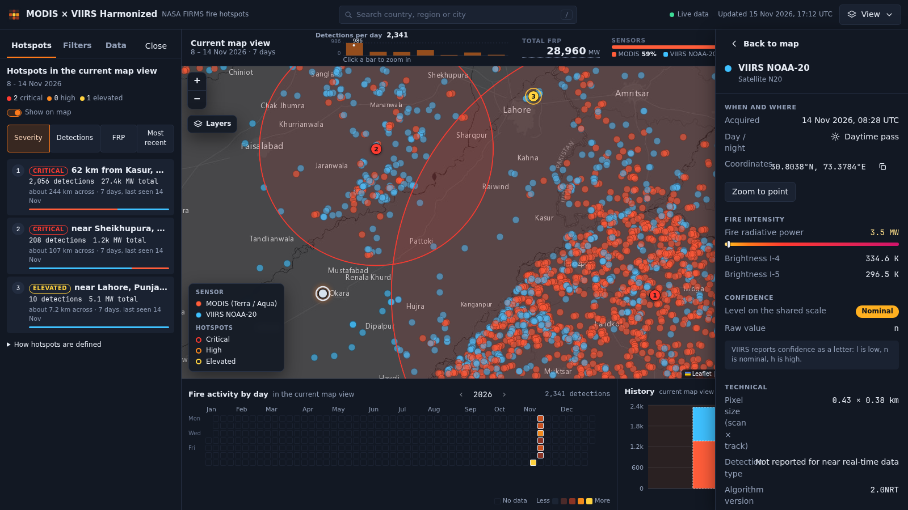

| Section | Content |
|---|---|
| Top | Sensor and satellite. If the detection belongs to a hotspot, its rank and a **Show hotspot** button. |
| **When and where** | Acquisition time in UTC, daytime or night-time pass, coordinates with a copy button, and **Zoom to point**. |
| **Fire intensity** | FRP with its position on a colour scale, and brightness temperatures: channels 21/22 and T31 for MODIS, I-4 and I-5 for VIIRS. |
| **Confidence** | The level on the shared scale, the raw value, and a line that explains how that sensor reports confidence. |
| **Technical** | Pixel size (scan × track), detection type, algorithm version, and a link to open the place in Google Maps. |

For Recent data, **Detection type** says "Not reported for near real-time data". That is expected: FIRMS adds the type only to Archive data.

**Back to map** closes the card.

## Calendar and history charts

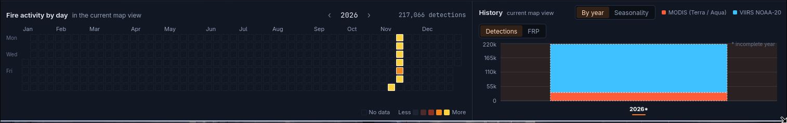

**Fire activity by day** (left) has one square per day of a year. Brighter means more detections; outlined empty squares are days with no data loaded.

- Click a day to set the period to that day.
- Drag across days to select a range. Shift-click extends the current selection.
- Click a month name to select that month.
- The arrows next to the year change the year.

**History** (right) compares longer stretches of time, split by sensor:

- **By year:** one stacked bar per year. A year marked with `*` is incomplete. Click a bar to show that year.
- **Seasonality:** the months of the year compared across years.
- **Detections / FRP** switches what is counted.

With only a few days of data loaded, the history chart has a single bar. It becomes useful once more periods are loaded.

## Loading data from FIRMS

The site shows what is in its database. The **Data** tab asks the backend to download more from NASA FIRMS.

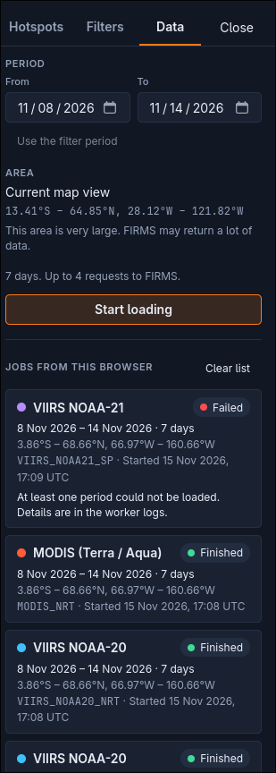

1. Move the map to the area you want, or select a place with the search box. The **Area** line shows which area will be used and its coordinates.
2. Open the **Data** tab.
3. Choose a **FIRMS product**. The list has two groups: near real-time and archive (standard processing), each with MODIS, VIIRS S-NPP, VIIRS NOAA-20 and VIIRS NOAA-21.
4. Set the **Period**: up to **31 days**, not ending after today (UTC). **Use the filter period** copies the dates from the Filters tab.
5. Check the line under the area. It says how many days and how many requests to FIRMS the job needs. A very large area gets a warning, because FIRMS may return a lot of data.
6. Press **Start loading**. The job appears under **Jobs from this browser**.
7. Wait for the status to become **Finished**. The map, summary and charts reload by themselves. If the loaded period is outside the one on screen, change the period in the Filters tab.

One job loads one product. To load MODIS and VIIRS for the same week, start a job for each.

### Job statuses

| Status | Meaning |
|---|---|
| Queued | Accepted, waiting for the worker. |
| Running | The worker is downloading and saving data. |
| Finished | All periods of the job were loaded. |
| Failed | At least one period could not be loaded. |
| No longer tracked | The backend keeps job results for one day; this job is older. |
| Status unavailable | The backend could not be asked for the status. |

### Why a job can fail

The most common reason is that FIRMS has no data for that product and period:

- **Archive products for recent dates.** Standard-processing data is published months after acquisition, so an Archive job for last week fails. Use a near real-time product for recent dates.
- **Near real-time products for old dates.** FIRMS keeps near real-time data only for the most recent weeks. Use an Archive product for older dates.
- **A satellite that has stopped delivering.** If a sensor's data ends on some date, a job after that date fails for that sensor only.

The other reasons are a FIRMS outage or the request limit of the FIRMS key. In both cases, start the job again later.

Repeating a job is safe. For Archive products, days that are already loaded for the same area are skipped. For near real-time products, the latest days are downloaded again, because FIRMS keeps adding to them. In both cases the same detection is never stored twice.

## View menu

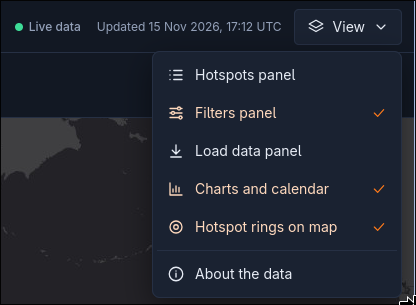

The **View** button in the header shows or hides parts of the screen: the Hotspots panel, the Filters panel, the Load data panel, the charts and calendar, and the hotspot rings on the map. **About the data** lists the data sources and the NASA acknowledgement.

## API

The backend API has an interactive reference at <https://modis-viirs-harmonized.duckdns.org/api/docs>. Every number on the site comes from these endpoints, and you can call them from that page. The project [README](../README.md#backend-api) lists them.

## Good to know

- **"Demo data" badge.** The backend did not answer when the page loaded, so the fires on the map are generated, not real. Reload the page. On the live site this badge should not appear.
- **An empty map.** No data is loaded for that area and period. Extend the period, move the map, remove a filter, or load the data in the Data tab.
- **The job list is per browser.** The site remembers the last 10 jobs started from this browser. Jobs started elsewhere do not appear, but the data they loaded does.
- **New data arrives when someone loads it.** The backend has a six-hourly schedule, but it works on saved areas and none are saved yet.
- **Anyone can start a download.** There is no sign-in. Please keep jobs to the area and period you need.
- **A detection is not a confirmed fire.** It is a thermal anomaly seen by a satellite. Low-confidence detections in particular can be industrial heat or sun glint.
- **All times are UTC.**
- **Not a NASA product.** This project is not affiliated with or endorsed by NASA. Data: NASA FIRMS and NASA GIBS; base maps: Esri; place names: Natural Earth.
